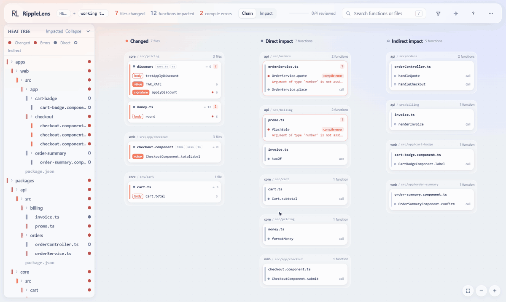
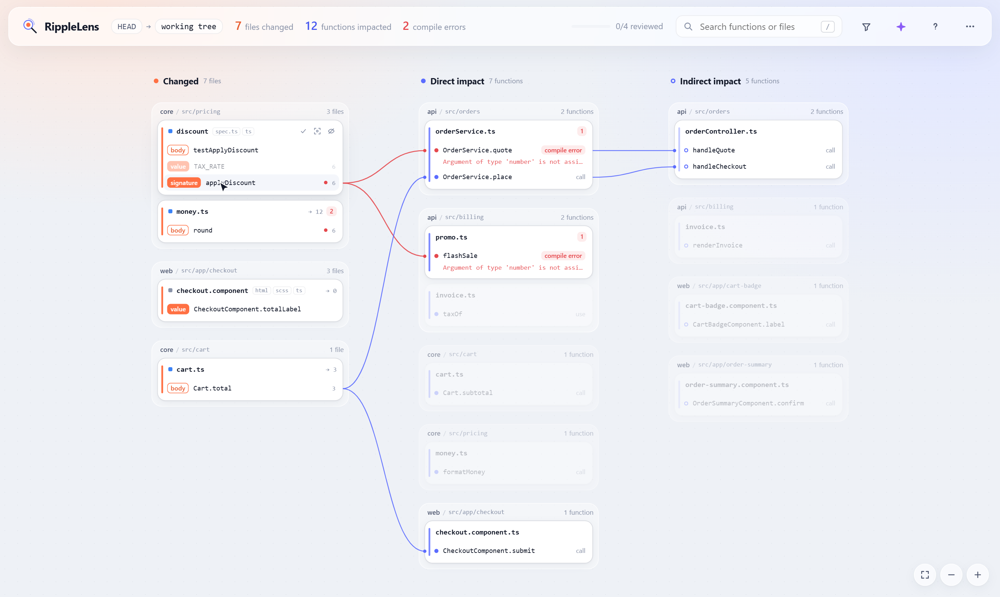
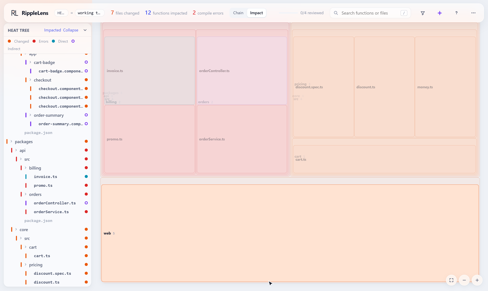
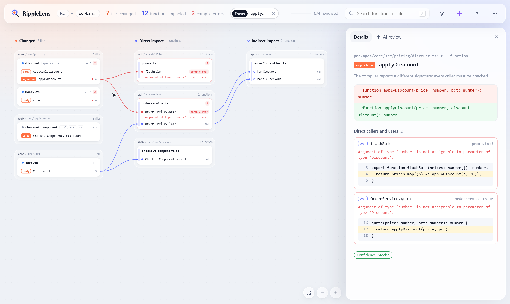
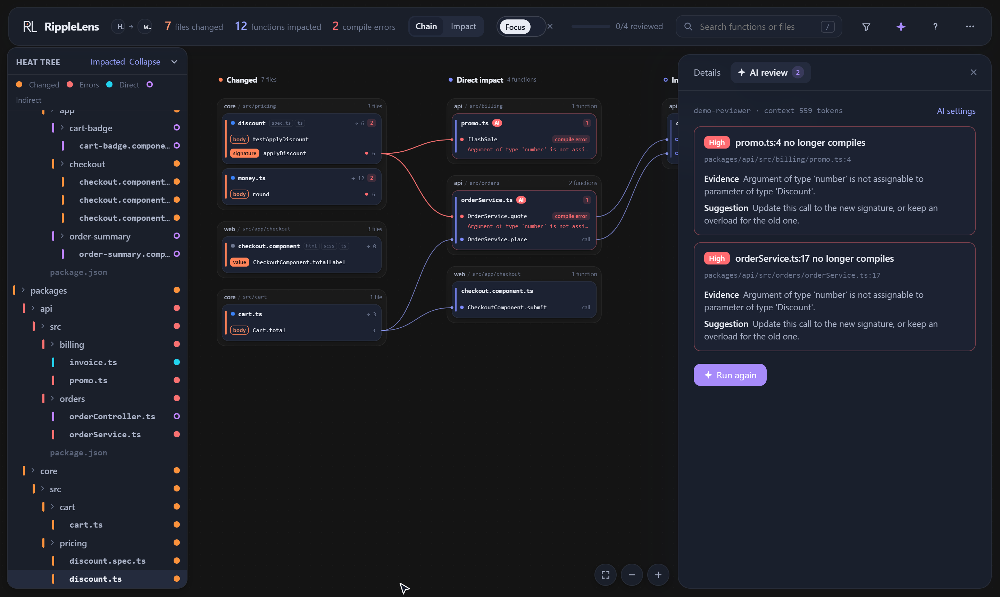

<p align="center">
  
</p>

<p align="center">
  <b>See what your diff really touches — function by function, proven by the compiler.</b><br/>
  <a href="README.zh-CN.md">中文</a>
</p>

<p align="center">
  
</p>

RippleLens takes a git diff, finds the functions, methods, types and constants you
changed, and asks the language's own compiler front end (through its language
server) who calls or uses them — then who calls *those*. The result is a ranked,
explained blast radius you can review in the browser, paste into a PR, or hand to
an AI reviewer through MCP.

| | |
|---|---|
| Hover a change | related wires appear; unrelated cards fade |
| Click to focus | signature diff, compile errors, call-site snippets |
| Scale | auto-collapse to files or groups when the graph is large |
| Optional AI | structured findings only — off until you configure it |





## 30-second quickstart

```bash
uvx --from git+https://github.com/XiaoYuTianTian/ripplelens.git ripplelens
cd your-repo
ripplelens doctor                # which servers are installed, what the project needs
ripplelens review                # analyze working-tree changes and open the UI
```

```bash
ripplelens analyze --base main                      # Markdown report (merge-base)
ripplelens analyze --format context --budget 3000   # token-bounded summary for an AI
ripplelens analyze --format json                    # impact.json
```

Try the multi-module TypeScript demo without installing anything else beyond a TS
language server:

```bash
python eval/demo.py shop          # opens the review UI on a sample monorepo
```

## Languages

| Language | Server | Notes |
|---|---|---|
| Go | `gopls` | `go install golang.org/x/tools/gopls@latest` |
| TypeScript / JavaScript | TypeScript ≥ 7 native LSP, or `typescript-language-server` | |
| Python | `basedpyright` | `pip install basedpyright` |
| Java | Eclipse JDT LS | JDK 21+; `jdtls` on `PATH` or `JDTLS_HOME` |
| C | `clangd` | needs `compile_commands.json` |
| C++ | `clangd` | same as C |

Servers are looked up on `PATH`, in `RIPPLELENS_TOOLS`, and in the RippleLens
cache `bin/`. A project `.lsp.json` (same shape as Claude Code's) can override any
server. Works on **Windows and Linux**.

## Accuracy and blind spots

Callers come from `callHierarchy`, `references`, `implementation` and type
hierarchy — not regex and not tree-sitter guessing. Every impacted entity carries
its shortest "why" path, a confidence (`precise`, `possible` for dynamic dispatch,
`degraded` with a reason), and any truncation is reported. Compile errors at
impacted call sites are flagged as breaking.

Static analysis cannot see reflection, function pointers / `std::function`,
`any`-typed calls, `getattr`, DI containers wired at runtime, or calls from
non-code resources. The report lists these blind spots for the languages in the
diff. C/C++ need a compilation database; Java needs a Maven/Gradle build that
jdtls can import.

Details: [docs/spec.md](docs/spec.md).



## Plugins

### Claude Code

```text
/plugin marketplace add XiaoYuTianTian/ripplelens
/plugin install ripplelens@ripplelens
```

Then restart Claude Code. You also need [uv](https://docs.astral.sh/uv/) on `PATH`
(`uvx`). The plugin does not come from PyPI: the first tool call runs

```text
uvx --from git+https://github.com/XiaoYuTianTian/ripplelens.git ripplelens mcp
```

which builds this repository (the review UI is already in `web_dist`). The
`/ripplelens:review [base]` command and skill tell Claude when to use the impact
data. After an edit, a hook marks the cached analysis stale.

The project you review must be a git repository. Install the language server for
each language you care about (`gopls`, `typescript-language-server`,
`basedpyright`, `jdtls`, `clangd`). `ripplelens doctor` says which one is missing.

### Cursor and Codex

`.cursor-plugin/` and `.codex-plugin/` share the same skill and MCP server.

MCP tools: `analyze_diff`, `get_impact`, `explain`, `get_review_context`,
`open_review_ui`.

## AI review (optional, off by default)

Configure an OpenAI-compatible or Anthropic endpoint in the UI (**AI → Settings**)
or with environment variables:

```bash
export RIPPLELENS_AI_BASE_URL=https://api.openai.com/v1   # or any compatible /v1
export RIPPLELENS_AI_MODEL=gpt-4.1-mini
export RIPPLELENS_AI_API_KEY=sk-...
# or Anthropic:
export RIPPLELENS_AI_PROVIDER=anthropic
export RIPPLELENS_AI_BASE_URL=https://api.anthropic.com
export RIPPLELENS_AI_MODEL=claude-sonnet-4-5
```

The key is stored in a user-level config file (never in `impact.json`, never sent
back to the browser). On first enable you are warned that code snippets from the
scoped context will be sent to the configured endpoint. Findings stream over SSE;
only evidence-backed issues are shown.

For local demos without a cloud key:

```bash
python eval/fake_model.py --port 8799
# then point the AI base URL at http://127.0.0.1:8799/v1
```



## How it works

1. `git diff -U0 -M` gives changed line ranges (working tree vs `HEAD`, or
   `merge-base(base, head)`).
2. `documentSymbol` maps lines to entities on both sides. The base side is read
   by opening the base text in the same server.
3. Each entity is classified — `signature`, `body`, `value`, `type`, `added`,
   `removed`, `renamed`, `cosmetic`.
4. Callers are traversed breadth-first: `incomingCalls`, plus `references` minus
   call sites, plus callers of overridden methods, plus implementations of
   changed interface methods. Removed entities are queried on a base-revision
   worktree.
5. Entities are grouped (Angular components, Java modules/packages, directory
   packages) for the board layout.
6. Diagnostics at call sites of signature/removal changes become `breaking`.

## Development

```bash
python -m venv .venv && .venv/bin/pip install -e ".[dev]"
npm --prefix web ci && npm --prefix web run build   # → src/ripplelens/web_dist
pytest tests/ -m "not lsp"                          # fast unit tests
pytest -m lsp                                       # end-to-end, needs servers
python eval/record.py                               # README screenshots + GIF (local Edge/Chrome)
```

## License

MIT
