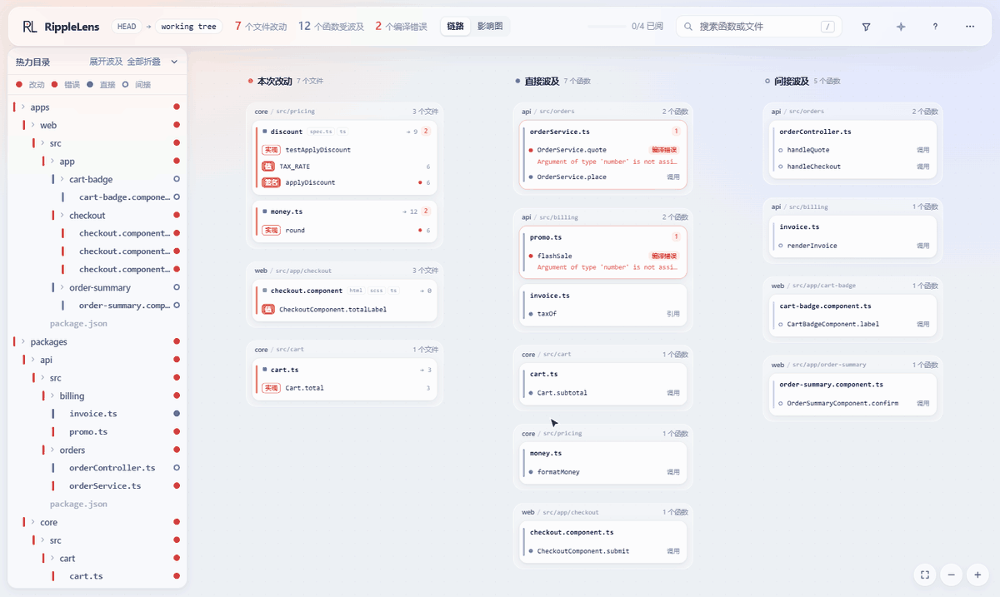
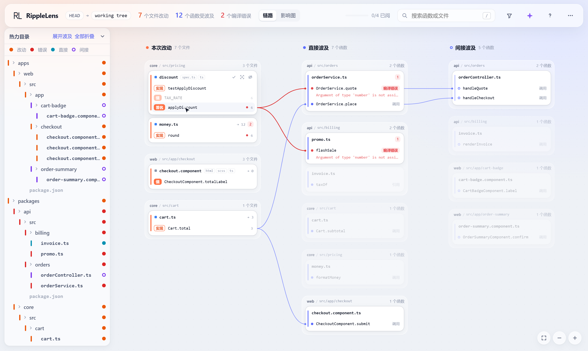
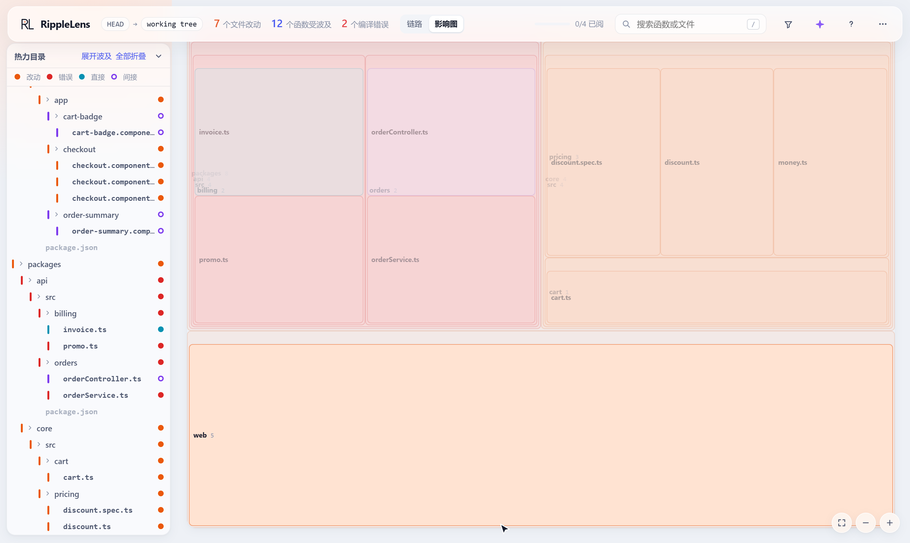
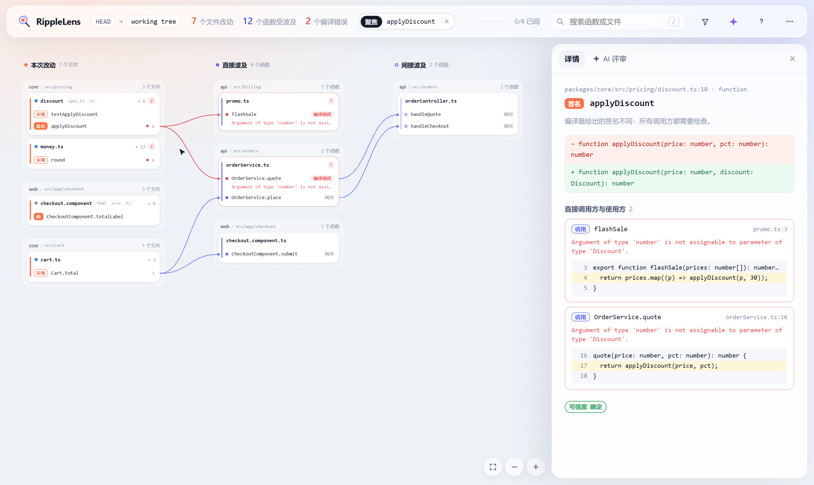
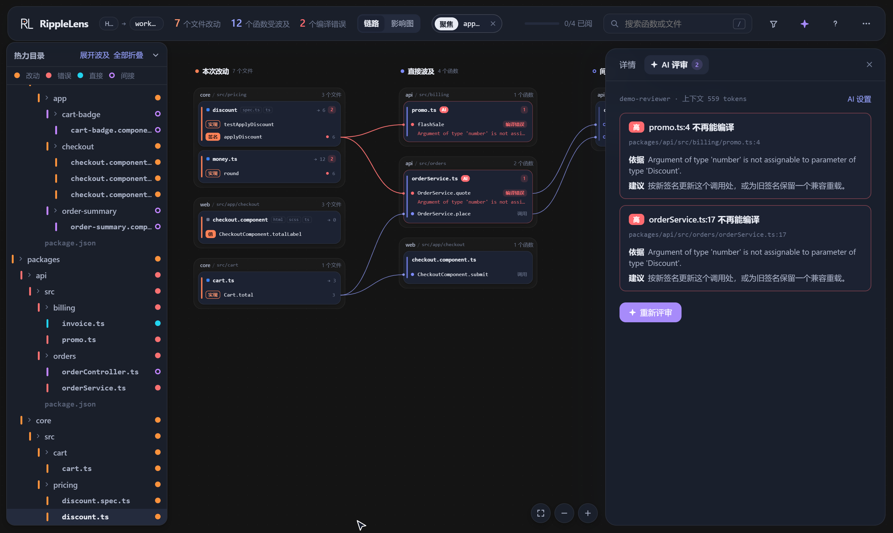

<p align="center">
  
</p>

<p align="center">
  <b>看清一次改动真正波及到哪里 —— 精确到函数，由编译器证明。</b><br/>
  <a href="README.md">English</a>
</p>

<p align="center">
  
</p>

RippleLens 读取 git diff，找出你改过的函数、方法、类型和常量，再通过该语言自己的
语言服务器（编译器前端）查询谁在调用或使用它们，以及再往上的调用方。结果是一份带
解释、可排序的波及范围：可以在浏览器里评审、贴进 PR，或通过 MCP 交给 AI 评审。

| | |
|---|---|
| 悬浮改动 | 只显示相关连线，无关卡片变淡 |
| 点击聚焦 | 签名对比、编译错误、调用处代码片段 |
| 规模 | 图太大时自动折叠到文件或分组 |
| 可选 AI | 只输出有证据的意见 —— 默认关闭，配好才启用 |





## 30 秒上手

```bash
uvx --from git+https://github.com/XiaoYuTianTian/ripplelens.git ripplelens
cd your-repo
ripplelens doctor                # 检查语言服务器与项目需求
ripplelens review                # 分析工作区改动并打开评审界面
```

```bash
ripplelens analyze --base main                      # Markdown 报告（merge-base）
ripplelens analyze --format context --budget 3000   # 给 AI 用的限 token 摘要
ripplelens analyze --format json                    # impact.json
```

装好 TypeScript 语言服务器后，可以直接看多模块演示：

```bash
python eval/demo.py shop          # 在示例 monorepo 上打开评审界面
```

## 支持的语言

| 语言 | 服务器 | 说明 |
|---|---|---|
| Go | `gopls` | `go install golang.org/x/tools/gopls@latest` |
| TypeScript / JavaScript | TypeScript ≥ 7 原生 LSP，或 `typescript-language-server` | |
| Python | `basedpyright` | `pip install basedpyright` |
| Java | Eclipse JDT LS | JDK 21+；`jdtls` 在 `PATH` 或设置 `JDTLS_HOME` |
| C | `clangd` | 需要 `compile_commands.json` |
| C++ | `clangd` | 同 C |

服务器会从 `PATH`、`RIPPLELENS_TOOLS` 以及 RippleLens 缓存目录 `bin/` 查找。项目里的
`.lsp.json`（与 Claude Code 同结构）可以覆盖任意服务器。支持 **Windows 与 Linux**。

## 准确度与盲区

调用方来自 `callHierarchy`、`references`、`implementation` 与类型层级，不是正则，
也不是 tree-sitter 猜测。每个受影响实体都带最短「为什么」路径、置信度
（`precise`、动态分派的 `possible`、带原因的 `degraded`），截断也会写明。受波及
调用处的编译错误会标成 breaking。

静态分析看不到反射、函数指针 / `std::function`、`any` 调用、`getattr`、运行时接线的
DI 容器，以及非代码资源里的调用。报告会按 diff 中的语言列出这些盲区。C/C++ 需要
编译数据库；Java 需要 jdtls 能导入的 Maven/Gradle 工程。

细节见 [docs/spec.md](docs/spec.md)。



## 插件

### Claude Code

```text
/plugin marketplace add XiaoYuTianTian/ripplelens
/plugin install ripplelens@ripplelens
```

装完后重开一次 Claude Code。机器上还要有 [uv](https://docs.astral.sh/uv/)（提供 `uvx`），并且在 PATH 里。插件不从 PyPI 安装程序，第一次调用会执行：

```text
uvx --from git+https://github.com/XiaoYuTianTian/ripplelens.git ripplelens mcp
```

uv 会从本仓库拉下代码并装好（评审界面已经打进 `web_dist`，不用再跑 npm）。`/ripplelens:review [base]` 命令和 skill 告诉 Claude 何时使用波及数据。编辑文件后，hook 会把缓存的分析结果标成过期。

被分析的项目必须是 git 仓库，并装好对应语言的语言服务器（`gopls`、`typescript-language-server`、`basedpyright`、`jdtls`、`clangd`）。缺哪个可以用 `ripplelens doctor` 看。

### Cursor 与 Codex

`.cursor-plugin/` 与 `.codex-plugin/` 共用同一套 skill 与 MCP 服务器。

MCP 工具：`analyze_diff`、`get_impact`、`explain`、`get_review_context`、
`open_review_ui`。

## AI 评审（可选，默认关闭）

在界面里 **AI → 设置** 配置 OpenAI 兼容或 Anthropic 端点，也可用环境变量：

```bash
export RIPPLELENS_AI_BASE_URL=https://api.openai.com/v1   # 或任意兼容 /v1
export RIPPLELENS_AI_MODEL=gpt-4.1-mini
export RIPPLELENS_AI_API_KEY=sk-...
# 或 Anthropic：
export RIPPLELENS_AI_PROVIDER=anthropic
export RIPPLELENS_AI_BASE_URL=https://api.anthropic.com
export RIPPLELENS_AI_MODEL=claude-sonnet-4-5
```

API Key 只写在用户级配置文件里（不会进 `impact.json`，也不会回传给浏览器）。首次
启用时会提示：范围内的代码片段会发往你配置的端点。意见通过 SSE 流式返回，只展示
有证据的问题。

本地演示（无需云端 Key）：

```bash
python eval/fake_model.py --port 8799
# 再把 AI Base URL 指到 http://127.0.0.1:8799/v1
```



## 工作原理

1. `git diff -U0 -M` 得到改动行（工作区对 `HEAD`，或 `merge-base(base, head)`）。
2. `documentSymbol` 把行映射到两侧实体；base 侧通过在同一服务器中打开 base 文本读取。
3. 实体分类：`signature`、`body`、`value`、`type`、`added`、`removed`、`renamed`、
   `cosmetic`。
4. 广度优先遍历调用方：`incomingCalls`、去掉调用点后的 `references`、被覆盖方法的
   调用方、变更接口方法的实现。被删除的实体在 base 修订的工作树上查询。
5. 按分组（Angular 组件、Java module/package、目录包）排布看板。
6. 签名/删除变更在调用处的诊断记为 `breaking`。

## 开发

```bash
python -m venv .venv && .venv/bin/pip install -e ".[dev]"
npm --prefix web ci && npm --prefix web run build   # → src/ripplelens/web_dist
pytest tests/ -m "not lsp"                          # 快速单测
pytest -m lsp                                       # 端到端，需要语言服务器
python eval/record.py                               # README 截图与 GIF（本机 Edge/Chrome）
```

## 许可证

MIT
